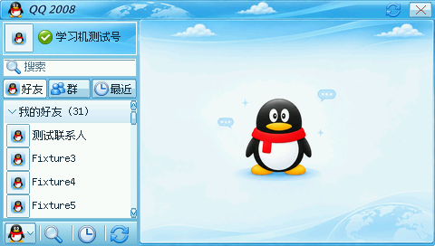
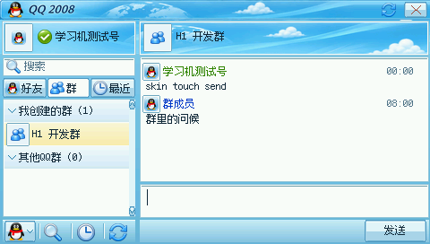
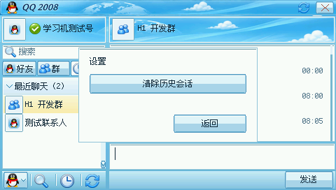

# H1 QQ

步步高 H1 / Y100 V1.41 的原生 QQ 客户端。QQ 协议与签名直接在 H1 的 MIPS CPU 上执行，ESP32-S3 提供通用联网；日常使用无需电脑常驻。本仓库按可复现发布结构整理，当前为私有开发仓库。

支持手机 QQ 扫码、有效登录恢复、好友/群分组与搜索、文字收发、群消息自动刷新、头像缓存、触摸滚动、本地消息与最近会话保存。界面参考 QQ 2008，正文使用原始 BDF 点阵字。群图片目前显示非文字消息提示，不提供完整图片聊天。

## 快速开始

尚未创建正式 Release。成品来自成功 Actions 的 `H1QQ-preview` artifact；本地构建后也可在 `dist/release/` 取得 BDA、安装 ZIP 和 `SHA256SUMS.txt`。

1. 准备 H1/Y100 V1.41 和支持 TCP 的 ESP32-S3 固件 **0.4.6 或以上兼容版本**。已在 N16R8 双 Type-C 板上联调：USB1 经 OTG 接 H1，USB2 供电，ESP 连接 2.4GHz Wi-Fi。接线与配网见固定 SDK 的 [硬件指南](sdk/docs/esp32-hardware.md) 和 [联网指南](sdk/docs/esp32.md)。
2. 将 H1 日期时间设置准确。把安装 ZIP 中的 `应用/` 合并复制到 H1 盘根目录，最终程序路径为 `A:/应用/程序/H1QQNative.bda`。
3. 首次使用，在电脑挂载 H1 磁盘后运行 `python PC初始化/init_data.py --root E:/`，把 `E:/` 换成实际盘符。工具使用系统随机源生成本机独立身份，默认 RTC 时区为 UTC+8；其他时区可传 `--utc-offset` 分钟数。已有身份只验证并保留。源码目录对应命令为 `python tools/init_data.py --root E:/`。
4. 安全弹出磁盘，关闭 H1 调试，再从桌面启动 QQ。手机 QQ 扫码确认后进入列表；下次启动先尝试恢复有效登录，失效再扫码。账号服务仍可能拒绝非官方客户端。

数据统一在 `A:/应用/数据/QQ/`。`H1QQ.ID` 是本机身份，`H1QQ.SES` 为加密登录缓存，`H<账号>.MSG` 为加密消息/最近会话日志，`AVATAR/` 为头像缓存。升级保留整个目录，安装包不包含任何预置身份或账号票据。

点击好友/群标签和分组，选择会话后点输入框编写，点发送；列表和消息区支持上下拖动。实体键：Q/W/E 切好友/群/最近，F 搜索，I 输入，Enter 打开/发送，R 刷新，返回退出会话。左下企鹅 → 设置 → 清除历史会话，确认后只清当前账号的本地消息与最近会话，取消保留记录。当前聊天视图显示最近12条，磁盘记录继续保留；最近页显示16个会话。

## 截图

以下为本项目实际链接 MIPS 程序的离线模型截图，使用合成账号和消息；不是 GPT 效果图，也不是本次独立构建的真机截图。二维码截图仅含无效测试域名。





验证范围和此前真机基线见 [验证记录](docs/verification.md)。

## 依赖

使用成品需要 H1/Y100 V1.41、ESP32-S3、上述联网固件，以及用于首次扫码的手机 QQ。SDK 固定在 `58bb60d2cf9b7783f5bc31ed35d6e28606871ec7`：

- [HelloClyde/bbk-h1-bda-sdk](https://github.com/HelloClyde/bbk-h1-bda-sdk)，以 `sdk/` git 子模块引用；不要直接替换为其他 BBK 机型 SDK。
- Windows GNU MIPS 15.2.0；SDK 安装器验证工具链压缩包 SHA-256。
- Python 3.12（CI）；构建和测试版本见 `requirements-build.txt`、`requirements-test.txt`。
- Pillow 仅用于确定性的图片打包；点阵字直接取固定 Fusion Pixel BDF / Unifont 像素。预生成头文件和原始素材均已保存。正常构建不调用图像生成服务。
- micro-ecc、Monocypher、cJSON，以及 SDK 媒体/堆/libc 依赖；完整来源和许可见 [THIRD_PARTY.md](THIRD_PARTY.md)。

### 开发构建

```powershell
git clone --recurse-submodules https://github.com/HelloClyde/BBKH1-QQ.git
cd BBKH1-QQ
git submodule update --init sdk
python -m pip install -r requirements-test.txt
python sdk/scripts/install_gnu_toolchain.py --dest .tools/toolchain
$env:H1_GNU_BIN = (Resolve-Path .tools/toolchain/bin).Path
python tools/check_repository.py
python tools/build.py
python tools/test_mips.py
python tools/package_release.py
```

需要访问私库的账号权限。工具链也可通过 `H1_GNU_BIN` 指向已安装的同版本目录。源码、SDK 与构建输出均按仓库相对路径组织，不依赖原开发工作区。

可选素材再生：`python tools/regenerate_assets.py`。Linux 主机可运行 `python tools/test_core.py` 检查原生算法向量；Windows 设置 `HOST_CC` 到本机 GCC 路径也可执行。生产 BDA 不链接 ARM 原库、解释器或 JIT。

main/PR 和手动工作流构建预览制品；符合 VERSION 的未来版本标签可触发预发布。当前推送源码不等同于已创建 Release，也不等同于新构建已在真机测试。

## 感谢

感谢步步高 H1 SDK 与设备研究贡献者、Switch QQ 项目及相关 QQ 协议研究、micro-ecc、Monocypher、cJSON、Fusion Pixel/Unifont 作者，以及参与接线、登录和界面真机测试的用户。通用 MIPS 固件模型与帧测试工具沿用本作者 H1 QQMusic 项目，来源与 GPL 许可保留。

QQ 名称、企鹅标志与相关商标归其权利人；本项目不是腾讯或步步高官方客户端。原创应用/工具采用 GPL-3.0，第三方及原库研究材料的权利范围分别说明，见 [来源与许可](THIRD_PARTY.md)。
